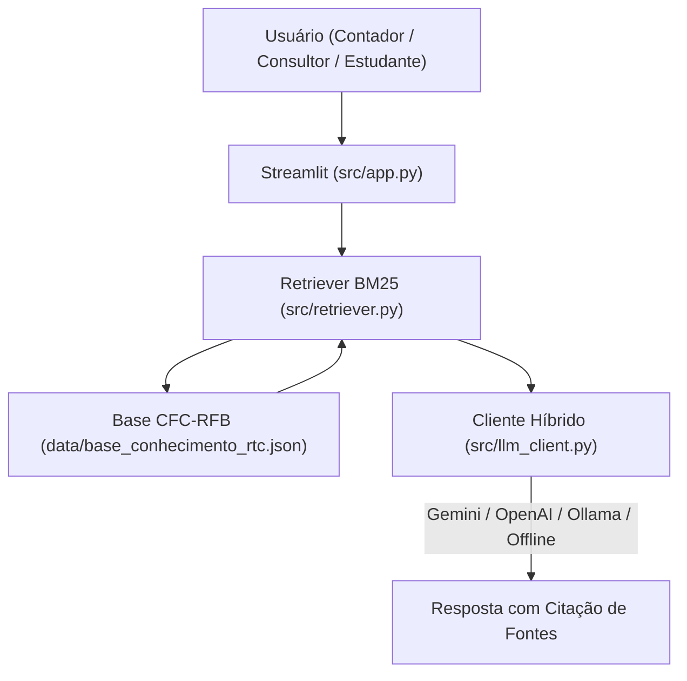

# ⚖️ TributaIA — Assistente Virtual da Reforma Tributária (CFC-RFB)

> Projeto desenvolvido para o Desafio de Projeto da DIO (**Construa Seu Assistente Virtual Com Inteligência Artificial**), adaptado para apoiar contadores, consultores e estudantes na consulta estruturada aos materiais do treinamento oficial da **Receita Federal (RFB) e Conselho Federal de Contabilidade (CFC)** sobre a Reforma Tributária do Consumo (RTC).

## 💡 O Que é o TributaIA?

O **TributaIA** é um assistente virtual baseado em IA Generativa com recuperação em base fechada (RAG lexical com BM25). Ele consulta **1.470 trechos indexados de 48 apresentações oficiais** do curso CFC-RFB (PDFs e PPTX), responde dúvidas de forma didática conforme o perfil do consulente e **sempre cita o módulo, o arquivo e a página/slide de origem**.

**O que o TributaIA faz:**
- ✅ Responde dúvidas sobre **IBS, CBS, Imposto Seletivo (IS), Simples Nacional, Obrigações Acessórias (NF-e, NFS-e, Cadastro, Calculadora RTC) e Regimes Específicos**;
- ✅ Adapta a profundidade e o tom da resposta ao perfil escolhido (Contador, Consultor/Estudante ou Empresário do Simples Nacional/MEI);
- ✅ Cita explicitamente as fontes oficiais (Módulo, Arquivo e Página/Slide);
- ✅ Admite quando não há informação suficiente na base ou quando a pergunta está fora de escopo;
- ✅ Sugere o próximo passo prático de estudo ou aplicação.

**O que o TributaIA NÃO faz:**
- ❌ Não inventa alíquotas, prazos ou dispositivos legais fora da base indexada;
- ❌ Não substitui parecer jurídico, contábil formal ou consulta oficial à Receita Federal;
- ❌ Não responde perguntas fora do contexto da Reforma Tributária do Consumo.

## 🏗️ Arquitetura



**Stack:**
- **Interface:** Streamlit (`src/app.py`)
- **Recuperação (RAG Lexical):** BM25 em Python puro (`src/retriever.py`)
- **Motor de IA (Híbrido):** Google Gemini (`google-genai`), OpenAI (`openai`), Ollama local (`requests`) ou Fallback Offline estruturado (`src/llm_client.py`)
- **Base de Conhecimento:** JSON/CSV extraídos das 48 apresentações do curso CFC-RFB (`data/`)

## 📁 Estrutura do Projeto

```text
assistente-reforma-tributaria/
├── data/
│   ├── base_conhecimento_rtc.json   # 1.470 trechos indexados das 48 apresentações CFC-RFB
│   ├── modulos_catalogo.csv         # Catálogo dos 48 arquivos (módulo, tipo, páginas/slides)
│   ├── conceitos_chave_rtc.json     # Resumo dos pilares da Reforma Tributária
│   └── perfis_consulente.json       # Perfis de usuário para adaptação de resposta
├── docs/
│   ├── 01-documentacao-agente.md    # Passo 1: Caso de uso, persona e arquitetura
│   ├── 02-base-conhecimento.md      # Passo 2: Organização e integração da base
│   ├── 03-prompts.md                # Passo 3: System prompt, exemplos e edge cases
│   ├── 04-metricas.md               # Passo 4: Avaliação, testes e métricas
│   └── 05-pitch.md                  # Passo 5: Roteiro do pitch (3 minutos)
├── src/
│   ├── app.py                       # Aplicação Streamlit (Passo 6)
│   ├── llm_client.py                # Orquestração híbrida (Gemini/OpenAI/Ollama/Offline)
│   ├── retriever.py                 # Busca BM25 sobre a base CFC-RFB
│   └── test_agente.py               # Testes automatizados de recuperação e edge cases
├── requirements.txt
└── README.md
```

## 🚀 Como Executar

### 1. Instalar dependências

```bash
pip install -r requirements.txt
```

### 2. Executar a aplicação Streamlit

```bash
streamlit run src/app.py
```

Na barra lateral da interface, você pode escolher o **Motor de IA**:
- **Automático (Híbrido):** usa `GEMINI_API_KEY`, `OPENAI_API_KEY`, Ollama local (`http://localhost:11434`) ou cai automaticamente para o **Modo Offline (Base Local)** caso nenhuma chave/servidor esteja ativo.
- **Offline (Base Local):** funciona 100% sem internet ou API key, retornando os trechos exatos do treinamento CFC-RFB.

### 3. Executar os testes automatizados

```bash
python src/test_agente.py
```
