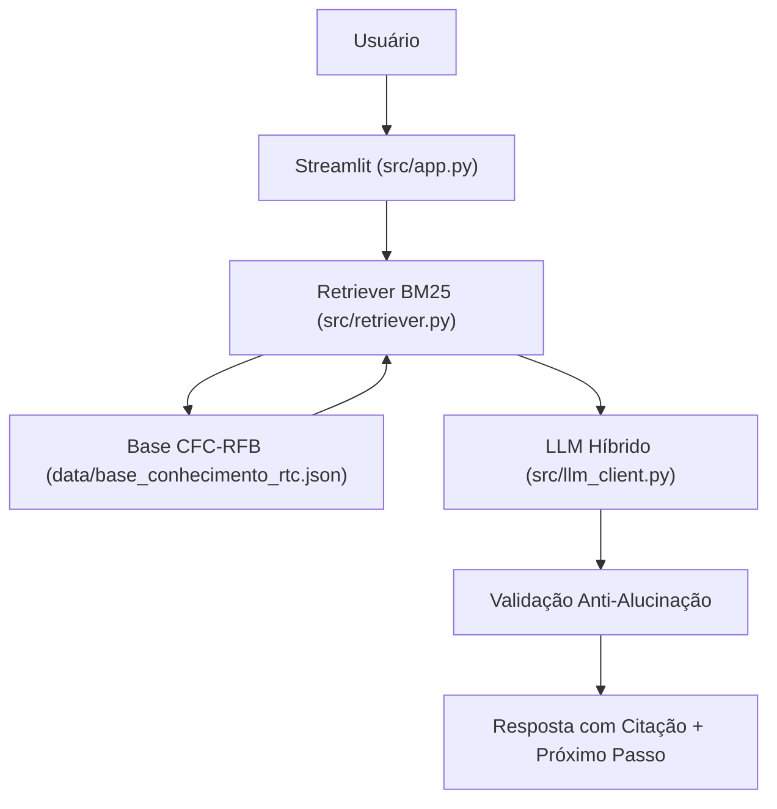

# Passo 1 — Documentação do Agente

## Caso de Uso

### Problema
A Reforma Tributária do Consumo (IBS, CBS e Imposto Seletivo) introduz mudanças profundas na legislação, nos documentos fiscais (NF-e, NFS-e), no cadastro de contribuintes, no Simples Nacional e em diversos regimes específicos. Profissionais de contabilidade e estudantes enfrentam grande volume de materiais (dezenas de apresentações e centenas de slides do treinamento oficial CFC-RFB), tornando demorado localizar rapidamente uma regra específica ou saber em qual módulo estudar o tema.

### Solução
O **TributaIA** organiza e indexa as 48 apresentações do treinamento Receita Federal (RFB) e Conselho Federal de Contabilidade (CFC) em uma base estruturada (`1.470` trechos) e utiliza busca BM25 + IA Generativa (modo híbrido) para responder dúvidas em linguagem clara, citar exatamente o módulo/arquivo/página de origem e sugerir o próximo passo.

### Público-Alvo
- Contadores e equipes de escritórios contábeis;
- Consultores tributários;
- Estudantes de Ciências Contábeis e profissionais em atualização sobre a RTC.

---

## Persona e Tom de Voz

### Nome do Agente
**TributaIA** (Assistente Virtual da Reforma Tributária — CFC/RFB)

### Personalidade
- Objetivo, didático e fundamentado exclusivamente nas fontes do treinamento;
- Transparente quanto a lacunas (admite quando não encontra base suficiente);
- Proativo ao indicar o módulo e o próximo passo de estudo ou verificação.

### Tom de Comunicação
Técnico-acessível: mantém a precisão dos termos tributários (IBS, CBS, IS, não cumulatividade, split payment, regimes específicos), mas explica em tópicos claros e adaptados ao perfil selecionado (Contador, Consultor/Estudante ou Simples Nacional/MEI).

### Exemplos de Linguagem
- **Saudação / Resposta fundamentada:** *"Com base no Módulo 8 do treinamento CFC-RFB (`Módulo 8 - CFC - RTC - Simples Nacional, MEI - Gustavo Salton - vf.pdf`, Página 2)..."*
- **Limitação / Fora de escopo:** *"Não encontrei informação suficiente nas apresentações do curso CFC-RFB para responder com segurança a essa pergunta."*
- **Próximo passo:** *"💡 Próximo passo: Recomendo consultar os materiais do Módulo 5 sobre NFS-e e Calculadora RTC."*

---

## Arquitetura

### Diagrama

### Componentes

| Componente | Descrição |
|------------|-----------|
| Interface | Streamlit (`src/app.py`) |
| Recuperador | Busca lexical BM25 em Python puro (`src/retriever.py`) |
| Motor de IA | Híbrido: Google Gemini, OpenAI, Ollama local ou Fallback Offline (`src/llm_client.py`) |
| Base de Conhecimento | JSON/CSV gerados a partir das 48 apresentações CFC-RFB (`data/`) |

---

## Segurança e Anti-Alucinação

### Estratégias Adotadas
- [x] Opera em contexto fechado: responde apenas com base nos trechos recuperados do curso CFC-RFB;
- [x] Limiar mínimo de relevância (`min_score = 8.0`) para evitar respostas forçadas em perguntas fora de escopo;
- [x] Citação obrigatória de Módulo, Arquivo e Página/Slide;
- [x] Temperatura baixa (`0.2`) nas chamadas aos LLMs para reduzir criatividade indesejada;
- [x] Admissão explícita quando a informação não está na base.

### Limitações Declaradas
- NÃO substitui parecer contábil/jurídico formal nem consulta oficial à Receita Federal;
- NÃO inventa alíquotas definitivas, prazos ou normas que não constem nos slides do curso;
- NÃO responde assuntos fora do domínio da Reforma Tributária do Consumo.
